<p align="center">
  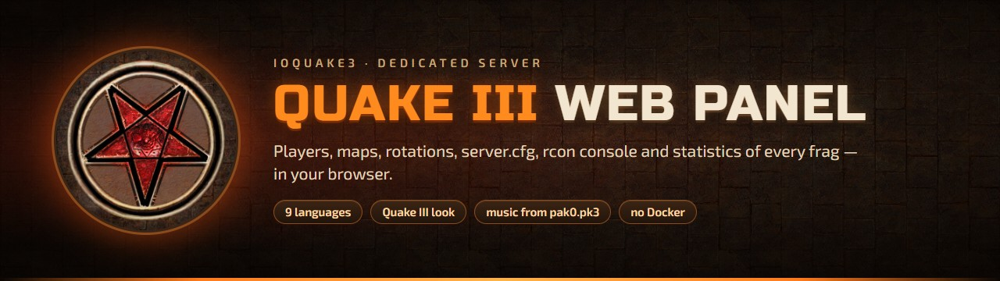
</p>

<p align="center">
  <a href="https://ioquake3.org/"></a>
  
  
  
  <br>
  
  
  
  <a href="LICENSE"></a>
</p>

<p align="center">
  <b>A web control panel for a Quake III Arena dedicated server running <a href="https://ioquake3.org/">ioquake3</a>.</b><br>
  One small Python program on the same machine as the game server — open it in a browser and run the server without the console.
</p>

<p align="center">
  <a href="#-screenshots"><b>📸 Screenshots</b></a> ·
  <a href="#-installation-step-by-step"><b>🚀 Install</b></a> ·
  <a href="#-where-everything-is-configured"><b>🧩 Configure</b></a> ·
  <a href="#-troubleshooting"><b>🩺 Troubleshooting</b></a>
</p>

<p align="center">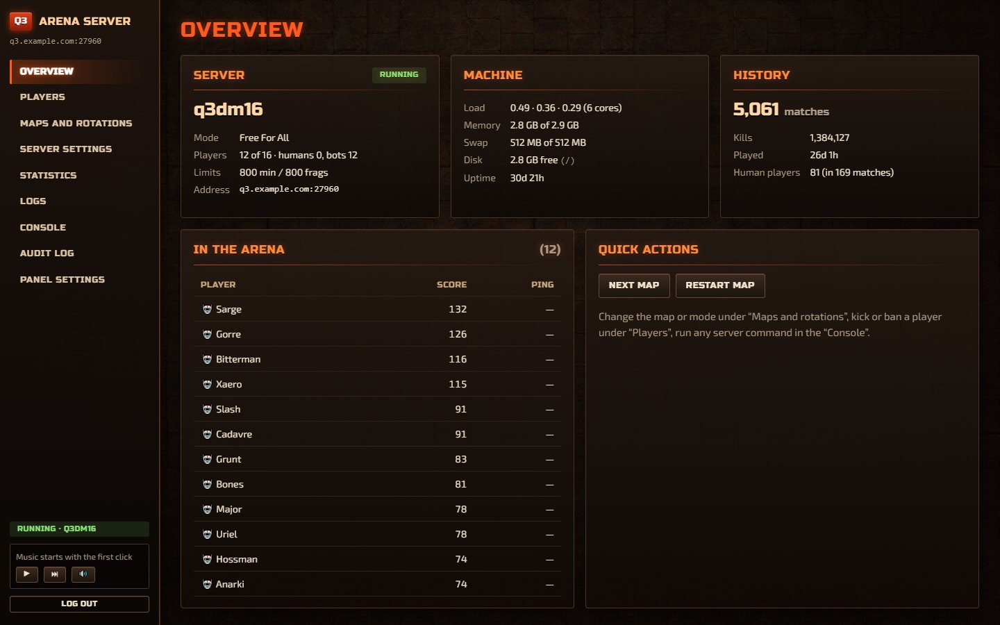</p>

## ✨ What it does

| | |
|---|---|
| 🏟️ **Overview** | Map, game mode, who is in the arena, machine load and memory, totals for all time — and hints when something is not set up yet. |
| 👥 **Players** | Kick, ban by IP (one address or the whole `/24`), unban, private message, message to everyone, add and remove bots. |
| 🗺️ **Maps and rotations** | What is playing and which map of its rotation; the **mode queue** (order, modes on and off); **load any map in the mode you choose** — with its picture and a hint whether the map was made for that mode; editors of the four rotations that offer only maps fitting the mode. |
| ⚙️ **Server settings** | The whole `server.cfg` as a form. A copy of the file before every save; changes go to the running server through rcon at once where possible. |
| 📊 **Statistics** | Every visit of a human player with date, country and IP; totals and a **player card** (weapons, maps, modes, where they play best, days of the week, hours); weapons, countries and records of humans; a calendar and a weekdays × hours heat map; bots separately; maps and recent matches. |
| 📜 **Logs · Console · Audit log** | `qconsole.log` and `games.log` with filter and auto-refresh; any rcon command with a reference of ioquake3 commands; every action done in the panel. |
| 🌍 **9 languages** | Russian, English, German, French, Spanish, Portuguese, Polish, Japanese, Chinese — the browser's language by default. |
| 🎨 **Quake III look** | Gothic, tech, space or lava background, menu sounds, the “Fight!” announcer and the game's soundtrack — all read from your own `pak0.pk3`. Or a plain light / dark look. |
| 📱 **Phone-friendly** | Every page fits a phone screen. |

> [!TIP]
> All you need is an **ioquake3 server that already runs** — started however you like — and Python.
> No helper scripts, watchdogs, batch files or Docker on the game server's side; no web server and no
> database server for the panel either. Statistics live in an SQLite file next to the panel.

## 📸 Screenshots

<table>
  <tr>
    <td width="50%">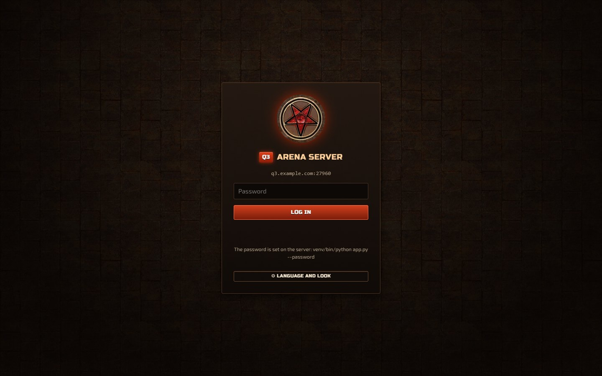<br><b>Login</b> — the Quake III look: textures and the emblem come from your <code>pak0.pk3</code></td>
    <td width="50%">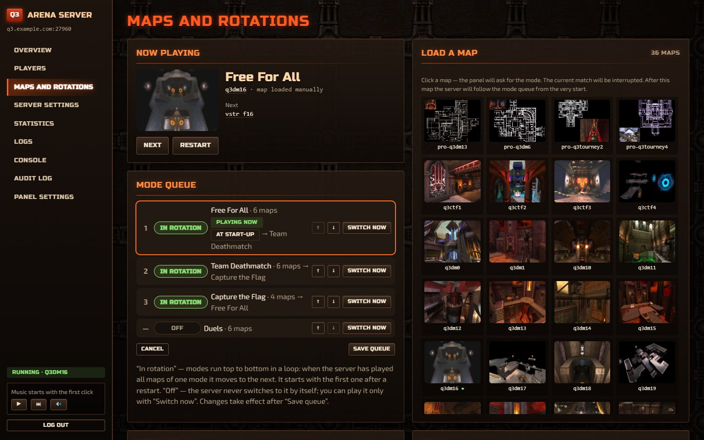<br><b>Maps and rotations</b> — what is playing, the mode queue and every map of the server</td>
  </tr>
  <tr>
    <td>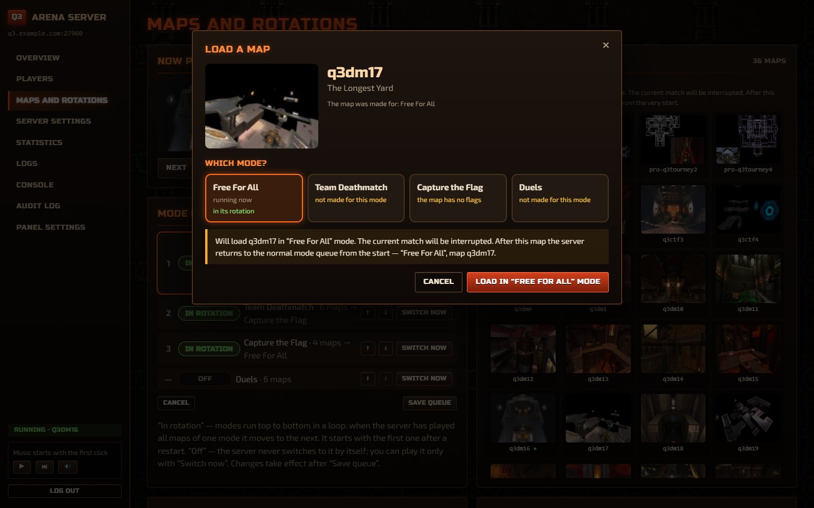<br><b>Load a map in any mode</b> — the panel tells whether the map was made for it</td>
    <td>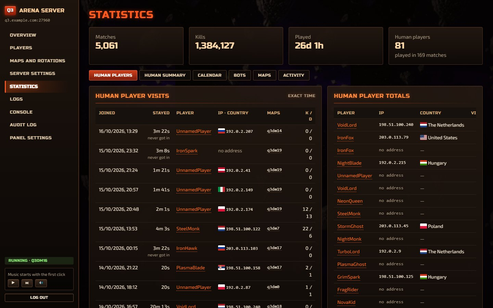<br><b>Human players</b> — every visit with time, country and IP</td>
  </tr>
  <tr>
    <td>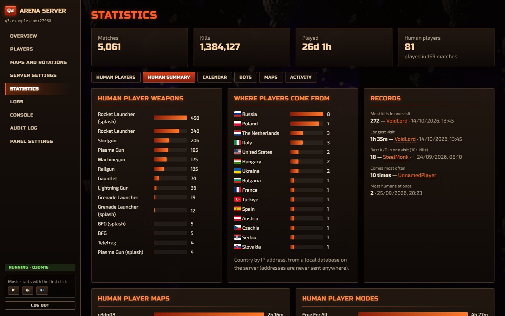<br><b>Human summary</b> — weapons, countries, records</td>
    <td>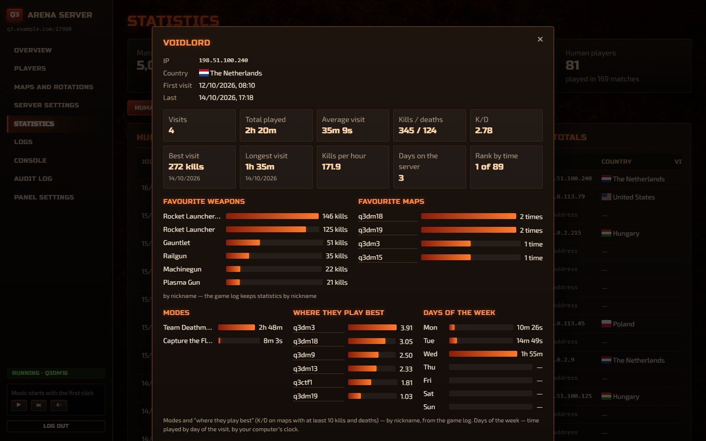<br><b>Player card</b> — weapons, maps, modes, best maps, days of the week</td>
  </tr>
  <tr>
    <td>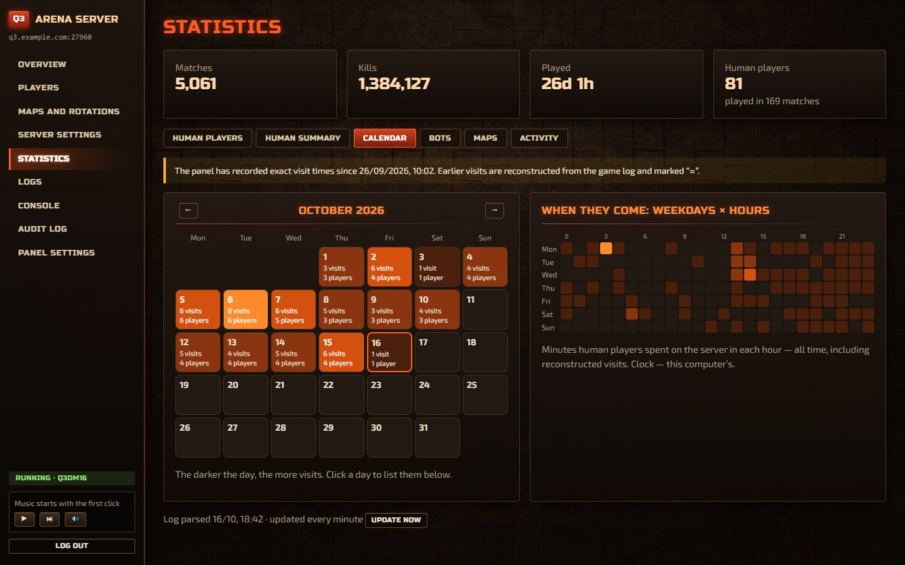<br><b>Calendar</b> — visits per day and a weekdays × hours heat map</td>
    <td>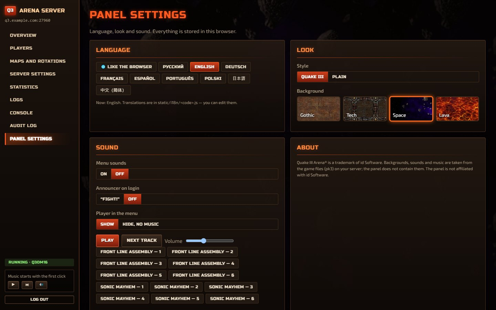<br><b>Panel settings</b> — 9 languages, 4 backgrounds, sounds and the game's music</td>
  </tr>
  <tr>
    <td>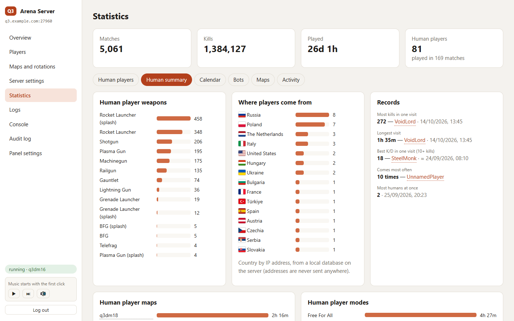<br><b>Plain look</b> — light…</td>
    <td>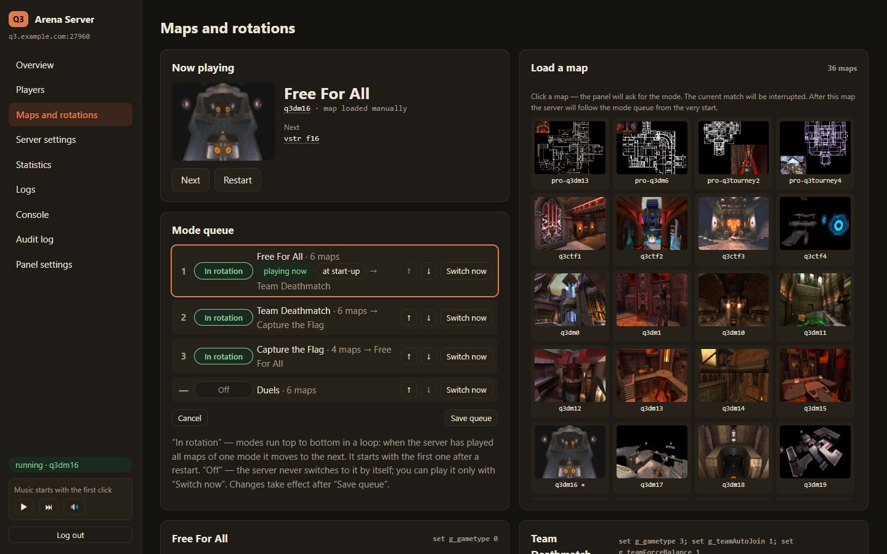<br>…and dark</td>
  </tr>
  <tr>
    <td>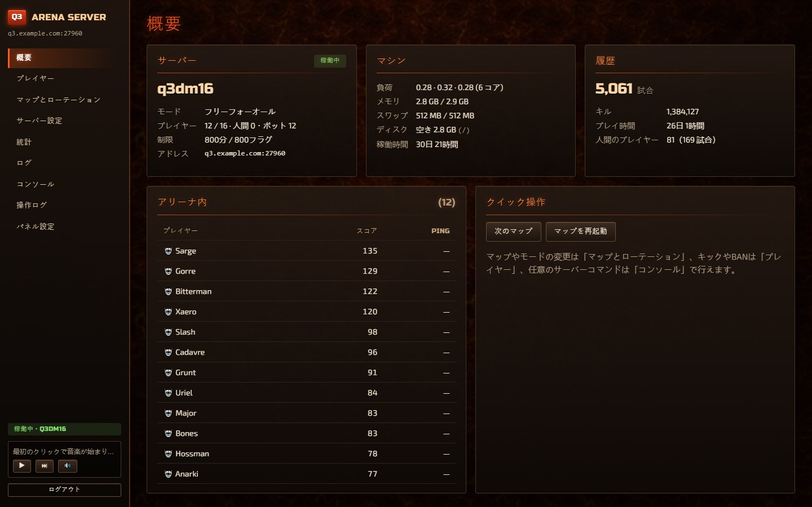<br><b>日本語</b> — and eight more languages</td>
    <td>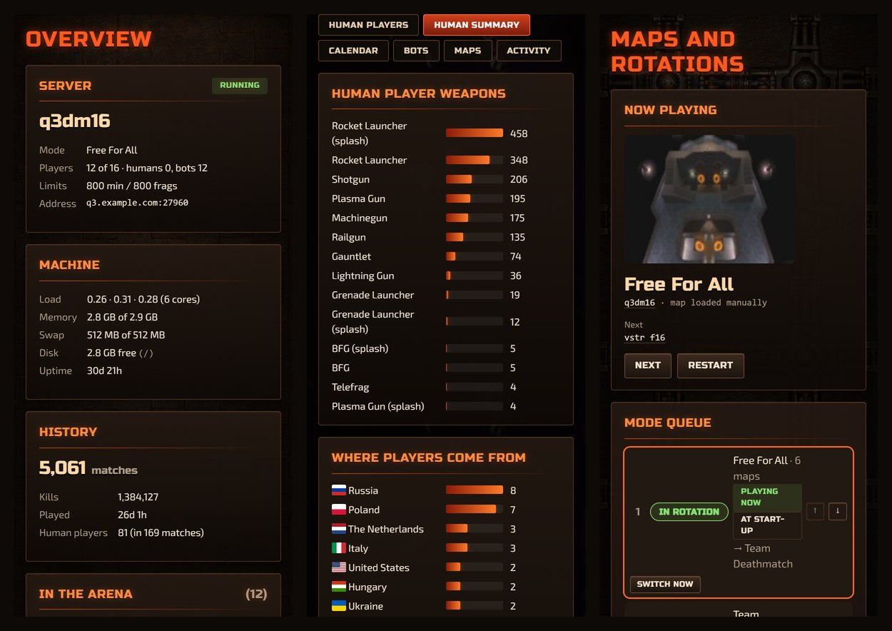<br><b>On a phone</b> — overview, statistics, maps</td>
  </tr>
</table>

<sub>The screenshots were taken with demo data: nicknames and IP addresses (from the ranges reserved for documentation) are made up.</sub>

---

## 📖 Contents

1. [Requirements](#-requirements)
2. [Installation, step by step](#-installation-step-by-step)
3. [Where everything is configured](#-where-everything-is-configured)
4. [Rotations and the mode queue](#-rotations-and-the-mode-queue)
5. [Updating](#-updating)
6. [How it works](#-how-it-works)
7. [Security](#-security)
8. [Troubleshooting](#-troubleshooting)
9. [Translations](#-translations)
10. [Project layout](#-project-layout)
11. [Legal](#-legal)

---

## 🧰 Requirements

| What | Notes |
|---|---|
| **ioquake3** dedicated server (`ioq3ded`) that already works | Tested with ioquake3 1.36. Other engines based on it should work if their rcon `status` looks the same. |
| **Linux** | Any distribution; the commands below are for Debian / Ubuntu. Machine load and memory on the Overview come from `/proc` (elsewhere they are just not shown). |
| **The same machine as the game server** | The panel reads `games.log`, `qconsole.log` and your pk3 files, and edits `server.cfg`. |
| **Python 3.8+** | With `aiohttp` and, optionally, `maxminddb` (installed below into a virtual environment). |
| Your **`pak0.pk3`** from Quake III Arena | Map pictures, map descriptions, backgrounds, sounds and music are read from your pk3 files. Without them the panel works, just plainer. |

The examples below assume:

- the game server runs as the Linux user **`quake`**;
- its home folder (fs_homepath) is **`/home/quake/.q3a`** — `baseq3/server.cfg` and the logs are there;
- `pak0.pk3` is in **`/opt/ioquake3/baseq3`** (fs_basepath);
- the panel goes to **`/opt/q3panel`**.

Replace these with your own paths and user everywhere.

---

## 🚀 Installation, step by step

### Step 1. Look at your server

Find the two folders the panel needs. The home folder with `server.cfg` and the logs:

```bash
ls /home/quake/.q3a/baseq3
```

The folder with `pak0.pk3` and your other pk3 files:

```bash
ls /opt/ioquake3/baseq3
```

ioquake3 keeps `server.cfg` and logs in `~/.q3a/baseq3` of the user it runs as, unless you start it with
`+set fs_homepath …` — then they are there.

### Step 2. Prepare `server.cfg`

The panel needs three lines in `server.cfg`:

```
seta rconpassword "a-long-password"   // without it the panel cannot control the server
seta g_log "games.log"                // without it there are no statistics
seta logfile 1                        // optional, gives exact dates of matches
```

> [!IMPORTANT]
> Restart the game server after adding them.

To use the rotation editor and the mode queue, write the
rotations in the format the panel understands — see [`server.cfg.example`](server.cfg.example) and
[Rotations and the mode queue](#-rotations-and-the-mode-queue). Everything else works with any `server.cfg`.

### Step 3. Install Python and git

```bash
sudo apt update
```

```bash
sudo apt install -y git python3 python3-venv
```

```bash
python3 --version
```

### Step 4. Download the panel and install its packages

```bash
sudo git clone https://github.com/bboyJohnn/Quake3-Servak-AdminPanel.git /opt/q3panel
```

```bash
sudo chown -R quake:quake /opt/q3panel
```

```bash
sudo -u quake python3 -m venv /opt/q3panel/venv
```

```bash
sudo -u quake /opt/q3panel/venv/bin/pip install -r /opt/q3panel/requirements.txt
```

(No git? Download the ZIP from GitHub, unpack it to `/opt/q3panel` and continue the same way.)

The panel runs as the same user as the game server: it reads the server's logs and pk3 files and writes
`server.cfg`.

### Step 5. Write the settings file `.env`

```bash
cd /opt/q3panel
```

```bash
sudo -u quake cp .env.example .env
```

```bash
sudo -u quake chmod 600 .env
```

```bash
sudo -u quake nano .env
```

Fill in the **REQUIRED** part:

```ini
Q3_HOME=/home/quake/.q3a
PAK_DIRS=/opt/ioquake3/baseq3
```

Everything else has a working default. The rcon password is read from `server.cfg`. Save the file
(`Ctrl+O`, `Enter`, `Ctrl+X` in nano).

Now set the password you will type to open the panel. It is stored only as a hash:

```bash
sudo -u quake venv/bin/python app.py --password
```

It asks for the password twice and writes only its hash (and a key for login cookies) into `.env`.

### Step 6. Check the setup

```bash
sudo -u quake venv/bin/python app.py --check
```

You get a list like this:

```
Settings: /opt/q3panel/.env
  ok   PANEL_PASSWORD_HASH      set
  ok   PANEL_SECRET             set
  ok   Q3_HOME                  /home/quake/.q3a
  ok   server.cfg               /home/quake/.q3a/baseq3/server.cfg
  ok   server.cfg writable      needed to save settings and rotations
  ok   rcon password            from server.cfg
  ok   Game log (g_log)         /home/quake/.q3a/baseq3/games.log — statistics come from it
  ok   Console log (logfile)    /home/quake/.q3a/baseq3/qconsole.log — optional, dates of matches
  ok   pk3 files                9 in /opt/ioquake3/baseq3, /home/quake/.q3a/baseq3
  ok   Quake III look           4 backgrounds, 8 sounds, 12 music tracks from pk3
  warn GeoIP database           optional, countries of players' IPs
  ok   Panel data folder        /opt/q3panel/data
  ok   getstatus 127.0.0.1:27960 My Quake III Server, map q3dm17, 3 players
  ok   rcon                     works
Panel will listen on 127.0.0.1:8091 and accept 127.0.0.1/32, ::1/128
```

> [!NOTE]
> `FAIL` lines must be fixed (see [Troubleshooting](#-troubleshooting)); `warn` lines are optional features.
> The command exits with code 0 when there are no `FAIL`s.

### Step 7. Start the panel

Try it first by hand — it prints `Panel: http://127.0.0.1:8091, …`; stop it with `Ctrl+C`:

```bash
sudo -u quake venv/bin/python app.py
```

To keep it running after you log out and after a reboot, let systemd start it. Create the file:

```bash
sudo nano /etc/systemd/system/q3panel.service
```

with this text (change `User=` and the paths if yours differ):

```ini
[Unit]
Description=Quake III web panel
After=network-online.target

[Service]
User=quake
WorkingDirectory=/opt/q3panel
ExecStart=/opt/q3panel/venv/bin/python /opt/q3panel/app.py
Restart=always
RestartSec=10

[Install]
WantedBy=multi-user.target
```

Then:

```bash
sudo systemctl daemon-reload
```

```bash
sudo systemctl enable --now q3panel
```

```bash
systemctl status q3panel
```

It should say `active (running)`. The panel's output and errors: `journalctl -u q3panel -f`.

This starts only the panel. Keep starting the game server the way you do now — the panel does not need
anything else from it.

### Step 8. Open the panel in your browser

By default the panel listens only on `127.0.0.1:8091` — it cannot be reached from outside. Pick one way:

**A. SSH tunnel (recommended, nothing to open on the server).** On your own computer (Linux, macOS, or
Windows PowerShell — OpenSSH is built in):

```bash
ssh -N -L 8091:127.0.0.1:8091 you@your-server
```

Keep it running and open **http://127.0.0.1:8091** in the browser. Log in with the password from step 5.

**B. Home network.** In `.env` set the panel to listen on all interfaces and allow your network:

```ini
PANEL_HOST=0.0.0.0
PANEL_ALLOWED_PEERS=127.0.0.1,::1,192.168.1.0/24
```

```bash
sudo systemctl restart q3panel
```

Open `http://<server-lan-ip>:8091`.

> [!WARNING]
> The panel speaks plain HTTP — **do not open this port to the internet.** From outside use the SSH tunnel (A)
> or a reverse proxy with HTTPS (C).

**C. From the internet, with HTTPS** — put nginx in front of the panel and keep the panel on `127.0.0.1`:

```nginx
server {
    listen 443 ssl;
    server_name panel.example.com;
    ssl_certificate     /etc/letsencrypt/live/panel.example.com/fullchain.pem;
    ssl_certificate_key /etc/letsencrypt/live/panel.example.com/privkey.pem;

    location / {
        proxy_pass http://127.0.0.1:8091;
        proxy_set_header Host $host;
    }
}
```

nginx connects from `127.0.0.1`, which is already allowed by default. A certificate: `sudo certbot --nginx`.

### Step 9 (optional). Countries of players

The panel shows a country next to every IP if it finds a country database in `.mmdb` format. Either one
works:

- **DB-IP "IP to Country Lite"** — free, no registration, CC BY 4.0:
  <https://db-ip.com/db/download/ip-to-country-lite>. Unpack it as `data/dbip-country-lite.mmdb`.
- **MaxMind GeoLite2-Country** — free after registration:
  <https://dev.maxmind.com/geoip/geolite2-free-geolocation-data>. Put it as `data/GeoLite2-Country.mmdb`.

```bash
sudo -u quake cp dbip-country-lite.mmdb /opt/q3panel/data/
```

The file is read locally — IP addresses are never sent anywhere. Replace the file to update it; the panel
notices the new file by itself within an hour. Another place: set `GEOIP_DB` in `.env`.

---

## 🧩 Where everything is configured

**`.env`** next to `app.py` — the only settings file of the panel. `.env.example` lists every key with a
comment. A value may refer to a key above it (`${Q3_HOME}/baseq3`); text after ` #` is a comment.

| Key | Default | What |
|---|---|---|
| `Q3_HOME` | — (required) | The server's home folder (fs_homepath) with `baseq3/server.cfg` and the logs. |
| `PAK_DIRS` | — (required) | Folders with `pak0.pk3` and other pk3 files, separated by `:`. The mod folder inside `Q3_HOME` is added automatically. |
| `PANEL_PASSWORD_HASH`, `PANEL_SECRET` | — (required) | Set by `app.py --password`. Emptying `PANEL_SECRET` and running it again logs everyone out. |
| `Q3_HOST`, `Q3_PORT` | `127.0.0.1`, `27960` | Where the game server answers `getstatus` and rcon. |
| `RCON_PASSWORD` | from `server.cfg` | Only if the server gets its rcon password some other way. |
| `PANEL_HOST`, `PANEL_PORT` | `127.0.0.1`, `8091` | Where the panel listens. |
| `PANEL_ALLOWED_PEERS` | `127.0.0.1,::1` | Addresses / networks allowed to connect at all (before the password). |
| `PANEL_TITLE` | the server's `sv_hostname` | Name in the menu and on the login screen. |
| `PANEL_ADDRESS` | `Q3_HOST:Q3_PORT` | The address for players shown under the menu and on the Overview, e.g. `q3.example.com:27960`. |
| `Q3_GAME` | `baseq3` | The mod folder inside `Q3_HOME`. |
| `SERVER_CFG`, `GAMES_LOG`, `CONSOLE_LOG` | `Q3_HOME/baseq3/…` | Only if your files are elsewhere. |
| `PANEL_DATA` | `./data` | The panel's own data (see below). |
| `GEOIP_DB` | `./data/GeoLite2-Country.mmdb` or `./data/dbip-country-lite.mmdb` | Country database (step 9). |

After editing `.env`: `sudo systemctl restart q3panel`.

**The panel's own data** — `data/` (created automatically, keep it when updating; for a backup `.env` and
`data/` are enough):

| Path | What |
|---|---|
| `panel.db` | SQLite: statistics, visits of players with IPs, audit log |
| `mode-order.txt` | Order of the mode queue as you set it in the panel |
| `cfg-backups/` | Copies of `server.cfg` before every change (the last 30) |
| `*.mmdb` | Optional country database, step 9 |

Pictures of maps (`static/maps/`) and the pieces of the Quake III look (`static/q3/`) are extracted from your
pk3 files at every start; they are not part of the repository.

**In the browser** — the **Panel settings** page (also the ⚙ button on the login screen), stored per browser:

- **Language** — follows the browser, or one of the 9.
- **Look** — *Quake III*: gothic stone, tech, space or lava background (textures from `pak0.pk3`), the game's
  orange headings, metal cards; or *Plain* with an automatic, light or dark theme.
- **Sound** — menu sounds and the "Fight!" announcer at login, and a music player in the menu with the
  soundtrack of Quake III: tracks are played straight from `pak0.pk3`, nothing is copied.

---

## 🔁 Rotations and the mode queue

Map loading, map changes and statistics work with any `server.cfg`. The rotation editor and the mode queue
understand this format (a full example: [`server.cfg.example`](server.cfg.example)):

```
set f1 "set g_gametype 0; map q3dm17; set nextmap vstr f2"
set f2 "map q3dm1; set nextmap vstr f3"
...
set f6 "map q3dm13; set nextmap vstr tdm1"     // after the last map — the next mode

set start_ffa     "vstr f1"
set start_tdm     "vstr tdm1"
set start_tourney "vstr tour1"
set start_ctf     "vstr c1"

vstr start_ffa                                 // the mode to start with
```

- Rotation keys: `f` — free for all, `tdm` — team deathmatch, `tour` — tournament, `c` — capture the flag.
- The first line of a rotation sets the mode (`set g_gametype …` and, for team modes, team settings).
- The last line says where to go next: back to the first line of its own rotation (the mode repeats) or to
  another rotation. That is the mode queue. Its order and which modes are on are easier to change in the panel.
- Section headers like `// 1. NAME AND ACCESS` become the group titles on the **Server settings** page.

The panel edits `server.cfg` line by line and keeps your comments and layout. Changes go to the running
server through rcon, without `exec server.cfg`.

**Loading a map in a chosen mode.** On **Maps and rotations** click a map picture. The panel asks for the
mode, tells whether the map was made for it (from the map's description in your pk3 files) and shows what
happens next:

- **there is a mode queue** — after this map the server goes through the queue from the start;
- **there is no queue** — after this map the server continues as before (its own `nextmap`).

---

## 🔄 Updating

```bash
cd /opt/q3panel
```

```bash
sudo -u quake git pull
```

```bash
sudo -u quake venv/bin/pip install -r requirements.txt
```

```bash
sudo systemctl restart q3panel
```

Then `Ctrl+F5` in the browser. Your `.env` and `data/` are not touched by `git pull`. If the database layout
changes in a new version, the panel updates it by itself at start.

---

## 🔧 How it works

- **`getstatus` over UDP** — the same query a server browser sends: map, mode, players, score, ping. Every
  20 seconds the panel notes who came and who left.
- **rcon over UDP** — control and the IP addresses of players (`status`). Every rcon command leaves a
  `Rcon from 127.0.0.1: …` line in the server log; the **Players** page asks `status` every 15 seconds while
  it is open.
- **Server files** — `games.log` (all statistics; new lines are read every minute, the position is remembered,
  so a truncated log does not lose anything), `qconsole.log` (the start time of the server, for dates of
  matches), `server.cfg` (read and edit), pk3 files (list of maps, pictures `levelshots/*.jpg`, descriptions
  `scripts/*.arena`, textures, sounds and music for the look).
- **`games.log` has no dates**, only the time since the map started. Dates of matches come from the start
  time written at the top of `qconsole.log` and from what the panel saw itself; gaps are filled by the
  length of matches and marked "≈". Exact times of visits and IP addresses exist from the first start of the
  panel; earlier visits are rebuilt from the game log where their matches have dates and are marked
  "no address".
- **A player is an IP address** — nicknames repeat. But weapons, modes and "where they play best" are
  counted **by nickname**: the game log has no addresses.
- **Loading a map in a mode** — one rcon request cannot carry several commands separated by `;`, so the
  panel writes them into a variable (`set panel_load "…"`) and runs it with `vstr panel_load`.
- **Music** is streamed from inside `pak0.pk3` with HTTP Range requests (the tracks are stored there
  uncompressed), so the player can seek and nothing is extracted.
- The panel does **not** start, stop or watch the game server process — keep running it the way you do
  now. The panel only talks to it over UDP and reads its files.

---

## 🔒 Security

- The panel **password** is stored as an scrypt hash; after 5 wrong attempts within 5 minutes logins pause
  for 5 minutes (one limit for everyone, not per address).
- The login cookie is `HttpOnly`, `SameSite=Strict`, signed with `PANEL_SECRET`, valid for 12 hours.
- Every request must come from an address in `PANEL_ALLOWED_PEERS`; every change request must carry a CSRF
  token; strict Content-Security-Policy — the page loads nothing from other sites.
- Everything sent to rcon is checked: map names — Latin letters, digits, `_` and `-`; bot names — Latin
  letters, digits and `_`; chat text — no quotes, `;` or line breaks.
- The rcon password is never sent to the browser, also not on the **Server settings** page.
- The panel itself has **no HTTPS**. Keep it on `127.0.0.1` and use an SSH tunnel or a reverse proxy with
  HTTPS. Never publish port 8091 to the internet.
- Whoever has the panel password can ban players and edit `server.cfg`. Use a long password.
- Keep `.env` at mode `600`.

---

## 🩺 Troubleshooting

| Symptom | Cause and fix |
|---|---|
| The browser shows just `Forbidden` | Your address is not in `PANEL_ALLOWED_PEERS`. Add it (or your network, e.g. `192.168.1.0/24`) and restart the panel. |
| `No panel password` at start | Run `venv/bin/python app.py --password`. |
| `--check`: **getstatus … no answer** | The game server is not running, or `Q3_HOST` / `Q3_PORT` differ from its `net_port`. |
| `--check`: **rcon** fails, "Bad rconpassword" | The rcon password in `server.cfg` is not the one the running server uses — restart the server or set `RCON_PASSWORD`. |
| No statistics | `seta g_log "games.log"` missing, or `GAMES_LOG` points to the wrong file. |
| Matches without dates or with "≈" | `seta logfile 1` missing (dates then come only from what the panel saw). |
| Saving settings fails with "Permission denied" | The panel runs as a different user than the owner of `server.cfg`. Run the panel as the server's user. |
| No map pictures, no backgrounds, sounds or music | `PAK_DIRS` does not contain the folder with `pak0.pk3`. |
| The rotation editor is empty | Your rotations are not in the panel's format — see [Rotations](#-rotations-and-the-mode-queue). |
| No countries next to IPs | No `.mmdb` database (step 9). |
| A yellow "Check the panel setup" box on the Overview | It names the path or setting to fix. |
| Any other error | `journalctl -u q3panel -n 100` shows the panel's errors; `venv/bin/python app.py --check` shows what it found. |

---

## 🌍 Translations

The interface is written in Russian; every text in `static/app.js` is wrapped in `L('…')`, and that Russian
text is the translation key. Dictionaries: `static/i18n/<code>.js`. Messages of the server (`app.py` and
the other modules) are translated in the browser with the same dictionaries. The language follows the
browser, or the choice on the **Panel settings** page.

All 9 languages are complete. A dictionary is a plain list of `"Russian text": "translation",` lines —
fix a word right in the file and reload the page. Keep the placeholders `{0}`, `{1}` — numbers and names go
there. A missing translation shows the Russian text, nothing breaks. Code comments are in Russian.

---

## 📁 Project layout

```
app.py                  the web server (aiohttp): settings, API, login, --password, --check
q3.py                   getstatus and rcon over UDP
cfg.py                  reading and editing server.cfg, rotations, the mode queue
stats.py                games.log parser, matches, dates from qconsole.log
humans.py               statistics of human players (cards, records, countries)
presence.py             who is online, visits with IPs
previews.py             map list, pictures and descriptions from pk3 files
q3assets.py             backgrounds, sounds and music of the Quake III look from pk3 files
geo.py                  countries of IPs from a local .mmdb file
sysinfo.py, audit.py    machine load from /proc; the audit log
static/                 the page: index.html, boot.js, app.js, app.css, i18n/<lang>.js, fonts/, flags/
.env.example            all settings with comments
server.cfg.example      a server.cfg with rotations in the panel's format
requirements.txt        aiohttp, maxminddb
```

---

## 📜 Legal

The panel's code is MIT (see [LICENSE](LICENSE)). Flags: [flag-icons](https://github.com/lipis/flag-icons),
MIT, see `static/flags/LICENSE`. Fonts: [Russo One](https://fonts.google.com/specimen/Russo+One) and
[Exo 2](https://fonts.google.com/specimen/Exo+2), SIL Open Font License, see `static/fonts/OFL-*.txt`.

Quake III Arena® is a trademark of id Software LLC, a ZeniMax Media company. This project is not affiliated
with or endorsed by id Software or ZeniMax. The repository contains no game files: map pictures, textures,
sounds and music are read from your own copy of the game.

The screenshots in `docs/` show artwork of Quake III Arena (textures, map pictures) that the panel reads from
the game's own files; it belongs to id Software.
